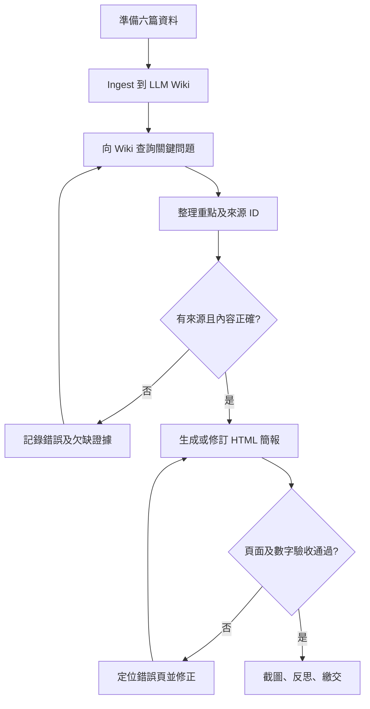

# Graph／Loop 設計與查核規則

## Graph 工作節點

## Loop 設計
1. 對每一個問題重複「Wiki 查詢 → 擷取段落 → 文件 ID 對照」。
2. 如找不到資料，改寫查詢詞；仍無結果就標記待查，不補造。
3. 對簡報每一頁重複「來源核對 → 數字核對 → 可讀性檢查」。
4. 一次最多修正 3 回合，再由人工判斷是否要重新整理文件，避免無限制重試。

## 必問 Wiki 問題（查詢後複製真實結果）
Q1 智慧補料要解決哪些問題？（W01）
Q2 基礎補料量公式是什麼？R001 為何等於 25？（W02）
Q3 為何優先順序是 R001 再 R003？（W03）
Q4 Tool Use Agent 的計算與排序工具如何分工？（W04）
Q5 Wiki/RAG 有哪些步驟與檢查點？（W05）
Q6 graph 的檢查節點發現公式錯誤，應退回哪一步？（W06）

## 產出前查核
- 是否已 ingest 至少五篇？留介面證據。
- 公式 `max(0,D+S-I)` 有來源 W02，三筆結果 25、0、13。
- 排序 R001→R003 有來源 W03。
- Tool Use 是規則式示範，勿宣稱 LLM 或真實企業 KPI。
- 每頁標出使用哪些 Wiki 文檔，方便審查。

## 真實流程／預製內容區別
本包的 Markdown 是準備好的**知識來源**；HTML 是**待 Wiki 查詢驗證的簡報初稿**。請在 LLM Wiki 真正查詢後核對內容並保留證據，才可說完成老師要求的整個流程。
